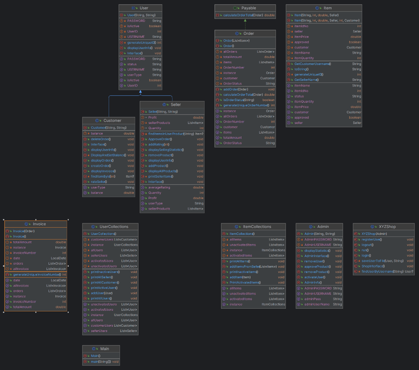

# XYZ Shop – Java Application

## Overview

A collaborative academic programming project developed as part of the Object-Oriented Programming (OOP) course during Semester One, 2023.

The project involves extending an existing XYZ Shop application using Java. Its main objective is to apply core Object-Oriented Programming concepts, particularly **Inheritance and Polymorphism**, while introducing additional functionalities for managing customers, sellers, products, orders, and invoices.

The application provides separate interfaces for administrators, customers, and sellers, allowing each user type to perform specific operations.

## Key Features

- User registration and login.
- Customer and seller account management.
- Admin user activation and management.
- Product management and approval.
- Customer order creation and deletion.
- Order and invoice management.
- Customer balance display.
- Seller rating functionality.
- Display of the top three sellers based on their selling totals.
- Display of selling statistics.
- Data storage and retrieval using text files.
- Exception handling and input validation.
- Collection-based management of users, sellers, customers, and items.

## Application Interfaces

### 1. Main Shop Interface

Provides the following options:

- Log in.
- Log out.
- Register as a customer or seller.

### 2. Admin Interface

Allows the administrator to manage the shop and its users.

- Activate users.
- Display inactive users.
- Display all products.
- Display all users.
- Display customers.
- Display sellers.
- Approve products.
- Remove users.
- Remove products.
- Display statistics.
- Exit.

### 3. Customer Interface

Allows customers to manage their shopping activities.

- Display orders.
- Create orders.
- Delete orders.
- Display account balance.
- Display invoices.
- Rate sellers.
- Exit.

### 4. Seller Interface

Allows sellers to manage their products and monitor their performance.

- Add products.
- Remove products.
- Display all products.
- Display selling statistics.
- Exit.

## Object-Oriented Design

The assignment requires the implementation of the following main classes and interface:

| Class / Interface | Description |
|---|---|
| `Payable` | Interface related to payment functionality. |
| `User` | Abstract class representing the common properties and behavior of users. |
| `Customer` | Represents customers and their shopping activities. |
| `Admin` | Represents the administrator responsible for managing the shop. |
| `Seller` | Represents sellers and their products and selling activities. |
| `Item` | Represents a product available in the shop. |
| `ItemCollections` | Manages collections of item objects. |
| `UserCollections` | Manages collections of user objects. |
| `Invoice` | Represents invoices related to transactions. |

### OOP Concepts Applied

- **Inheritance:** Reusing common attributes and methods through the abstract `User` class and its subclasses.
- **Polymorphism:** Supporting different user behaviors through shared parent-class references and overridden methods.
- **Abstraction:** Defining common structures and behavior through abstract classes and interfaces.
- **Encapsulation:** Organizing data and controlling access to object attributes.

## Technologies & Tools

- Java
- Eclipse IDE / IntelliJ IDEA
- Object-Oriented Programming (OOP)
- Inheritance
- Polymorphism
- Abstract Classes and Interfaces
- Java Collections
- File Handling (Text Files)
- Exception Handling
- Input Validation

## UML Class Diagram

The following UML class diagram illustrates the overall structure of the XYZ Shop application, including its main classes, attributes, methods, interfaces, and relationships.

## Team Collaboration

This project was a collaborative academic group assignment focused on extending a shop management application using object-oriented programming principles.

The assignment involved designing and implementing user management, product management, shopping operations, payment-related functionality, and data persistence.

## Project Objectives

The main objectives of this project were to:

1. Apply inheritance and polymorphism in a Java application.
2. Design and implement abstract classes and interfaces.
3. Manage users and products using Java Collection classes.
4. Implement different functionalities for administrators, customers, and sellers.
5. Store and retrieve user information using text files.
6. Apply exception handling and input validation.
